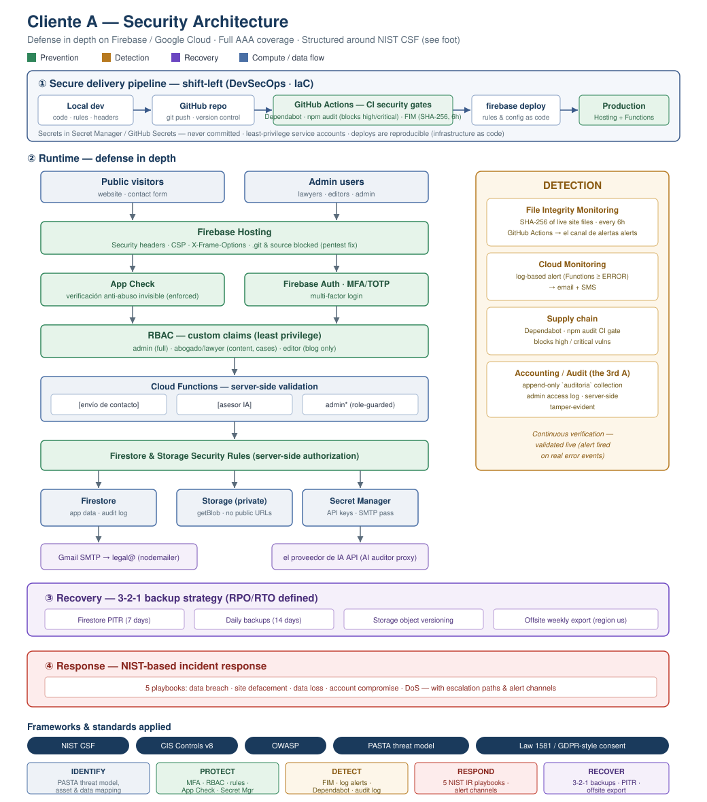

# Security Portfolio — Belona Cybersecurity

**Belona Cybersecurity LLC** · Powder Springs, Georgia
[belonacyber.com](https://belonacyber.com) · contact@belonacyber.com

> **On anonymization.** The work documented here is real and was performed under
> authorization from the owner. The client's name and infrastructure identifiers
> were replaced with placeholders (`Client A`, `cliente-a`) before publication.
> **Belona Cybersecurity does not publish identifiable client data without written
> authorization** — the same rule we apply to every engagement.

---

Hardening a production legal-services web platform on **Firebase / Google Cloud** — end to end, as the sole technical owner. This folder documents the security engineering work: authentication, authorization, penetration testing with remediation, backups/DR, monitoring, threat modeling, and data-protection compliance — applying DevSecOps practices (security-as-code, CI security gates) throughout.

> **Start here:** [`case-study-devsecops-troubleshooting-EN.pdf`](case-study-devsecops-troubleshooting-EN.pdf) — a 2-minute executive summary of the whole engagement.

*Defense-in-depth architecture — prevention (green), detection (amber), recovery (purple).*

---

## Impact summary

| Area | What was delivered |
|---|---|
| **Authentication** | MFA/TOTP on the admin panel (resolved a session-timing enrollment blocker) |
| **Authorization** | Role-based access control (admin / lawyer / editor) enforced by Firestore & Storage security rules |
| **Pentest** | 3-phase authorized test; found & remediated a **critical** `.git` + GitHub-token exposure served by Hosting |
| **Recovery** | 3-2-1 backups: PITR (7d) + daily backups (14d) + object versioning + offsite weekly export |
| **Detection** | File Integrity Monitoring (SHA-256, every 6h) + Cloud Monitoring log alerts + Dependabot / `npm audit` CI gate |
| **Secrets** | API keys migrated from `.env` to Google Secret Manager |
| **Compliance** | Consent capture + proof; privacy-policy international-transfer clause (Colombia's Law 1581, analogous to GDPR/CCPA) |

**Result:** full **AAA** coverage (Authentication, Authorization, Accounting) and defense in depth across prevention / detection / recovery — with **no added third-party attack surface** and **no added recurring cost**.

---

## Documents

| # | Document | What it covers |
|---|---|---|
| 1 | [Case Study — DevSecOps](case-study-devsecops-troubleshooting-EN.pdf) | Executive overview of the full engagement (**read this first**) |
| 2 | [Penetration Test Report](pentest-report-cliente-a-EN.pdf) | Recon, authz testing, privilege-escalation attempts, findings & remediation |
| 3 | [PASTA Threat Model (stages 3–7)](pasta-threat-model-stages-3-7-EN.pdf) | Decomposition, threats, CWE/OWASP mapping, attack trees, residual-risk matrix |
| 4 | [Backup & DR Runbook](backup-runbook-cliente-a-EN.pdf) | 3-2-1 strategy, RPO/RTO, restore procedures |
| 5 | [Incident Response Playbooks](incident-response-playbooks-EN.pdf) | 5 NIST-based playbooks (breach, defacement, data loss, account compromise, DoS) |
| 6 | [Security Awareness Training](security-awareness-training-EN.pdf) | 7 modules mapped to CIS Control 14 / NIST CSF PR.AT |
| 7 | [Lab Report — Firewall & Port Scanning](lab-report-firewall-port-scanning-EN.pdf) | Hands-on nmap/VPC lab: open/closed/filtered states + SSH hardening finding |
| 8 | [Cheat Sheet — Firewall / nmap / GCP](cheatsheet-firewall-nmap-gcp-EN.pdf) | Command reference for the lab above |

*Each document is also available in Markdown (`.md`) alongside the PDF.*

---

## Tech stack

**Cloud:** Firebase (Hosting, Authentication / Identity Platform, Firestore, Storage, Cloud Functions gen2 · Node 24), Google Cloud Platform, App Check (reCAPTCHA v3), Secret Manager, Cloud Monitoring, Cloud Scheduler.
**Security:** IAM / RBAC (custom claims), security rules as code, MFA/TOTP, penetration testing (nmap), File Integrity Monitoring (Python + GitHub Actions), Dependabot, PASTA threat modeling, NIST incident response.

## Skills demonstrated

Cloud security (GCP/Firebase) · IAM & RBAC · security rules as code · penetration testing & remediation · secrets management · backup / disaster recovery (3-2-1, RPO/RTO) · detection engineering (FIM, log-based alerting) · supply-chain security · threat modeling (PASTA) · incident response (NIST) · security awareness · data-protection compliance (Law 1581 / GDPR-style).

---

*Production platform: a Colombian law firm's public website + admin panel. Work performed by the sole technical owner as a self-directed Cloud Security / DevSecOps portfolio project.*
