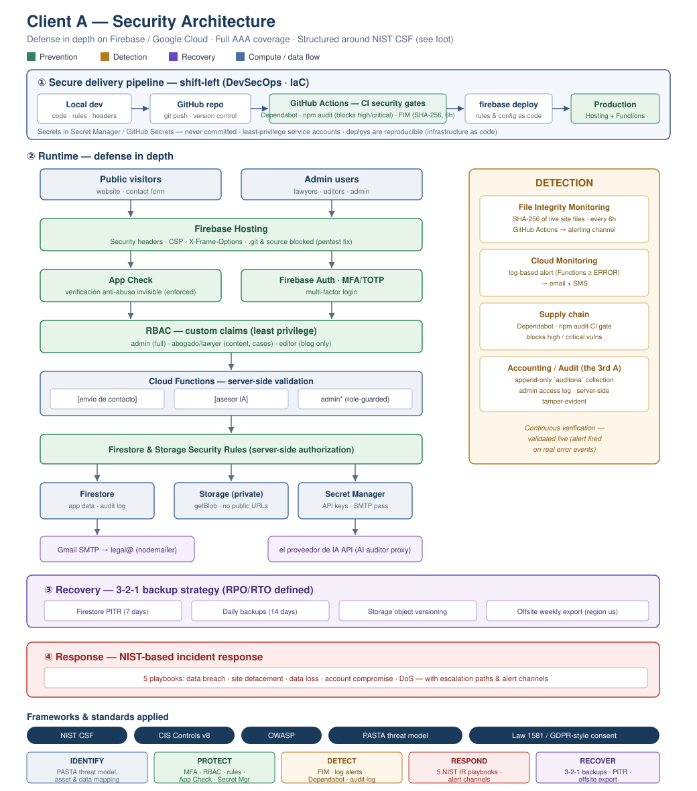

# Portafolio de seguridad — Belona Cybersecurity

**Belona Cybersecurity LLC** · Powder Springs, Georgia
[belonacyber.com](https://belonacyber.com) · contact@belonacyber.com

> *English version: [`../README.md`](../README.md)*

> **Sobre la anonimización.** Los trabajos aquí documentados son reales y se
> realizaron con autorización del propietario. El nombre del cliente y los
> identificadores de su infraestructura se reemplazaron por marcadores
> (`Cliente A`, `cliente-a`) antes de publicarlos.
> **Belona Cybersecurity no publica datos identificables de un cliente sin su
> autorización por escrito** — la misma regla que aplicamos a cada encargo.

---

Trabajo de ingeniería de seguridad sobre la **plataforma web en producción de una
firma legal**, en **Firebase / Google Cloud**, ejecutado de punta a punta como
responsable técnico único: autenticación, autorización, prueba de intrusión con
remediación, respaldos y recuperación, detección y monitoreo, modelado de
amenazas y cumplimiento en protección de datos — aplicando **prácticas DevSecOps**
(seguridad como código, controles de seguridad en la integración continua) en
todo el recorrido.

> **Empiece por aquí:** [Caso de estudio — DevSecOps](caso-de-estudio-devsecops.md)
> — resumen ejecutivo de todo el encargo, en dos minutos.

*Arquitectura de defensa en profundidad — canal de integración con seguridad
desplazada al inicio, prevención en ejecución, detección, respuesta y
recuperación, mapeadas al marco NIST CSF.*

---

## Resumen de impacto

| Área | Qué se entregó |
|---|---|
| **Autenticación** | Segundo factor con código temporal en el panel de administración (incluyó resolver un bloqueo de registro por el momento de la sesión) |
| **Autorización** | Control de acceso por roles (administrador / abogado / editor), aplicado por reglas de seguridad del servidor |
| **Prueba de intrusión** | Prueba autorizada en tres fases; se encontró y corrigió una exposición **crítica** de código fuente y de una credencial de repositorio |
| **Prevención de abuso** | Verificación anti-abuso y límite de tasa en el servidor, en el formulario de contacto |
| **Endurecimiento** | Política de contenido permitido, cabeceras de seguridad y secretos movidos a un almacén cifrado gestionado |
| **Recuperación** | Respaldos 3-2-1: punto en el tiempo (7 d) + copias diarias (14 d) + versionado de documentos (90 d) + copia semanal fuera del sitio |
| **Detección** | Vigilancia de integridad de archivos (huella criptográfica, cada 6 h) + alertas sobre registros + revisión de dependencias en cada cambio |
| **Cumplimiento** | Captura de consentimiento con prueba almacenada y cláusula de transferencia internacional en la política de privacidad (Ley 1581 de Colombia, análoga al RGPD) |

**Resultado:** cobertura **AAA** completa —autenticación, autorización y registro
de actividad— y defensa en profundidad en prevención, detección y recuperación,
**sin añadir terceros** a la frontera de confianza y **sin costo recurrente
nuevo**.

---

## Documentos

| # | Documento | Qué cubre |
|---|---|---|
| 1 | [Caso de estudio — DevSecOps](caso-de-estudio-devsecops.md) | Resumen ejecutivo de todo el trabajo (**empiece por aquí**) |
| 2 | [Informe de prueba de intrusión](informe-de-pentest.pdf) | Reconocimiento, pruebas de autorización, intentos de escalada, hallazgos y remediación |
| 3 | [Modelo de amenazas PASTA (etapas 3–7)](modelo-de-amenazas-pasta.pdf) | Descomposición, amenazas, mapeo a vulnerabilidades conocidas, árboles de ataque, riesgo residual |
| 4 | [**Capacidad de recuperación: de "hay respaldos" a "se puede restaurar"**](recuperacion-ante-desastres.md) | RPO/RTO, regla 3-2-1, y **un control documentado como implementado que no lo estaba** — encontrado al ir a probar la restauración |
| 5 | [**Autenticación de correo: SPF, DKIM y DMARC**](autenticacion-de-correo.md) | Despliegue por etapas (`none` → `quarantine` → `reject`), lectura del primer informe DMARC y una migración de DNS **sin un minuto de correo caído** |
| 6 | [**Endurecimiento de un formulario de contacto**](endurecimiento-del-formulario.md) | Ocho capas sobre una función de borde — captcha verificado en el servidor, trampa para robots, secretos fuera del disco — **cada una probada en producción** |
| 7 | [Playbooks de respuesta a incidentes](playbooks-de-respuesta.pdf) | Cinco playbooks basados en NIST (filtración, alteración del sitio, pérdida de datos, cuenta comprometida, denegación de servicio) |
| 8 | [Programa de formación en seguridad](formacion-en-seguridad.pdf) | Siete módulos alineados a CIS Control 14 / NIST CSF PR.AT |

*Cada documento existe en Markdown (`.md`) junto al PDF.*
*Las versiones en inglés están en [la raíz del repositorio](../).*

---

## Tecnologías

**Nube:** Firebase (hosting, autenticación, base de datos, almacenamiento,
funciones de servidor), Google Cloud Platform, verificación de origen de
aplicación, almacén de secretos, monitoreo y tareas programadas.

**Seguridad:** gestión de identidades y control de acceso por roles con
reivindicaciones personalizadas, reglas de seguridad como código, segundo factor
con código temporal, política de contenido permitido, prueba de intrusión,
vigilancia de integridad de archivos, revisión automática de dependencias,
modelado de amenazas PASTA y respuesta a incidentes según NIST.

## Competencias demostradas

Seguridad en la nube · gestión de identidades y accesos · reglas de seguridad
como código · prueba de intrusión y remediación · gestión de secretos · respaldos
y recuperación ante desastres (3-2-1, RPO/RTO) · ingeniería de detección ·
seguridad de la cadena de suministro · modelado de amenazas (PASTA) · respuesta a
incidentes (NIST) · formación en seguridad · cumplimiento en protección de datos.

---

*Plataforma en producción: sitio público y panel de administración de una firma
legal. Trabajo ejecutado por el responsable técnico único. Los valores sensibles
—claves, credenciales y datos de clientes— están deliberadamente excluidos de
este repositorio.*

<!-- atribucion -->
---

*Del portafolio técnico de **Belona Cybersecurity LLC** — Powder Springs,
Georgia · [belonacyber.com](https://belonacyber.com) · contact@belonacyber.com*

*© 2026 Belona Cybersecurity LLC. Todos los derechos reservados. Publicado para
evaluación por clientes potenciales y empleadores; los términos están en
[`LICENSE`](../LICENSE).*
